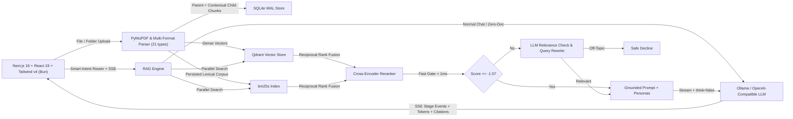

<div align="center">


# Owly RAG

**A high-speed, local-first document Q&A and conversational assistant built from scratch** on **FastAPI**, **Qdrant**, **bm25s**, **Cross-Encoder Reranking**, **Ollama**, and **Next.js 16 + React 19 + TypeScript**, guided by **Owly**, your animated assistant mascot.

<p>
  
  
  
  
  
  
</p>
<p>
  
  
  
  
  
  
</p>
<p>
  
  
  
  
</p>

</div>

##  Meet Owly

<table>
  <tr>
    <td align="center" width="140">
      
      <br />
      <strong>Owly</strong>
    </td>
    <td>
      <strong>Owly</strong> is the interactive animated SVG mascot powering the workspace experience in <code>Mascot.tsx</code> and <code>PipelineActivity.tsx</code>. Owly reacts in real time to every user and backend event:
      <ul>
        <li> <strong>Greeting &amp; Idle:</strong> Waves hello on launch and hover, blinks naturally, and greets you in the welcome view.</li>
        <li> <strong>Curious Listening:</strong> Perks up attentively while you type in the chat composer.</li>
        <li> <strong>Searching &amp; Running:</strong> Sweeps an animated magnifying glass and sprints left or right across pipeline stages with dust puffs and stride motion.</li>
        <li> <strong>Writing:</strong> Holds an animated stylus over a glowing notepad with ink sparks while streaming responses.</li>
        <li> <strong>Celebrating &amp; Retry:</strong> Celebrates grounded answers with sparkles or turns thoughtful and runs back to rephrase when retrieval fails.</li>
      </ul>
    </td>
  </tr>
</table>

##  Architecture



##  Key Features

-  **Hybrid Retrieval + RRF:** Parallel Qdrant dense semantic search and disk-persisted `bm25s` lexical matching fused with Reciprocal Rank Fusion (`k=60`) and contextual `[Document | Section]` child prefixes.
-  **Smart Intent Routing & Normal Chat:** Chat naturally with Owly at any time (even before uploading files) or ask grounded questions across your documents, complete with multi-turn pronoun resolution and whole-document overview sampling for summaries and quizzes.
-  **Self-Correcting CRAG & Visual Pipeline Journey:** Interactive SVG diagram shows Owly moving through each backend stage live in plain language (searching files, picking top sections, checking relevance, rewriting on retry, and writing the response), while disabling redundant hidden thinking loops (`think: false`) on hybrid thinking models.
-  **Citation Passage Locator:** Clicking any source chip opens `CitationDrawer` with the matched passage and highlighted excerpt.
-  **21 Supported File Types + Hardened Ingestion:** Fast PyMuPDF PDF parsing (tables + layout + optional OCR fallback), `.docx`, `.pptx`, `.xlsx`, `.html`, `.json`, `.md`, `.csv`, `.txt`, and source/config files (`.py`, `.ts`, `.tsx`, `.js`, `.jsx`, `.css`, `.sql`, `.yaml`, `.toml`) with upload size limits, filename sanitization, and OpenXML zip-bomb protection.
-  **Multi-Session Chat & Controls:** Server-synced sessions (`/chat/[sessionId]`), SQLite-backed job recovery across reloads, document-scoped filtering, personas and query modes (`Smart Auto`, `Normal Chat`, `Summarize`, `Compare`, `Extract Facts`, `Study Quiz`), temperature/top-K sliders, `Ctrl/Cmd+K` search, Stop & Regenerate, Read Aloud, and Markdown export.
-  **Smart Hardware Advisor & Model Switcher:** Auto-detects CPU/RAM/GPU (`CUDA`, `MPS`, `ROCm`, `CPU`), recommends hardware-matched models, discovers any extra pulled Ollama models, and supports one-click **Use Model**, **Install**, **Install Missing**, **Reinstall**, and **Uninstall**.
-  **Workspace Backup & Restore:** Strict schema-validated JSON backup/restore of indexed documents, chunks, sessions, and chat history.

##  Hardware-Tiered Models & Providers

| Tier | Generator LLM (Ollama) | Dense Embedding | Cross-Encoder Reranker |
|---|---|---|---|
| **Ultra-Light / CPU** (`< 6.5 GB`) | `qwen3:1.7b` (1.4 GB) | `BAAI/bge-small-en-v1.5` (384d) | `cross-encoder/ms-marco-MiniLM-L-6-v2` |
| **Standard Laptop** (`8–12 GB VRAM / 16 GB MPS`) | `qwen3.5:4b` (3.3 GB · 256K ctx) | `Qwen/Qwen3-Embedding-0.6B` (1024d · 32K ctx) | `mixedbread-ai/mxbai-rerank-base-v1` |
| **Pro Workstation** (`16–24 GB VRAM`) | `qwen3.5:9b` (6.6 GB · 256K ctx) | `Qwen/Qwen3-Embedding-0.6B` (1024d · 32K ctx) | `BAAI/bge-reranker-v2-m3` |
| **Enterprise GPU** (`24+ GB VRAM`) | `qwen3.5:27b` (17.0 GB · 256K ctx) | `BAAI/bge-m3` (1024d · 8K ctx) | `BAAI/bge-reranker-v2-m3` |

*(You can also switch to any locally pulled Ollama model from the Hardware & Model Manager modal, or configure `OPENAI_BASE_URL` / `OPENAI_API_KEY` for an OpenAI-compatible provider.)*

##  Tech Stack

| Layer | Technologies |
|---|---|
| **Backend** | Python 3.11+, FastAPI, Uvicorn, Qdrant (embedded/server), SQLite (WAL mode), `structlog`, `httpx` |
| **Retrieval & Ingestion** | `sentence-transformers`, `bm25s`, `pymupdf`, `pdfplumber`, `python-docx`, `python-pptx`, `openpyxl`, `beautifulsoup4` |
| **LLM Runtime** | Ollama (local streaming & keep-alive) + optional OpenAI-compatible external endpoint |
| **Frontend** | Next.js 16 (App Router + Turbopack), React 19, TypeScript 6, Tailwind CSS v4, Zustand, TanStack Query, Motion, Lucide Icons |
| **Quality & E2E** | `ruff`, `pyright`, `pytest`, `eslint`, Playwright |
| **Package Managers** | **uv** (Python) and **Bun** (Frontend), with `pip` and `npm`/`pnpm`/`yarn` support |

##  How to Start Locally (Step-by-Step Guide)

### Prerequisites
- **Python >= 3.11**
- **[Ollama](https://ollama.com/)** installed and running
- **[uv](https://docs.astral.sh/uv/)** (Python package manager) and **[Bun](https://bun.sh/)** (Frontend runtime/package manager)

### Step 1: Clone & Configure Environment

```bash
git clone https://github.com/rugved-danej/owly-rag.git
cd owly-rag
cp .env.example .env          # Linux / macOS
# Windows PowerShell: Copy-Item .env.example .env
```

Key settings in `.env.example`:

| Variable | Default | Description |
|---|---|---|
| `DATA_DIR` | `./data` | Directory for SQLite DB, Qdrant storage, `bm25s` index, and temp uploads |
| `QDRANT_URL` | *(empty)* | Leave empty for zero-config embedded Qdrant; set for remote Qdrant |
| `OLLAMA_BASE_URL` | `http://localhost:11434` | Local Ollama endpoint |
| `CORS_ORIGINS` | `http://localhost:3000,http://127.0.0.1:3000` | Allowed frontend origins |
| `MAX_UPLOAD_BYTES` | `52428800` | Maximum per-file upload size (50 MB) |
| `OVERRIDE_TIER` | *(empty)* | Override auto-detected hardware tier (`ultra_light`, `standard_laptop`, etc.) |
| `PARENT_CHUNK_SIZE` | `1400` | Parent context window character budget |
| `CHILD_CHUNK_SIZE` | `350` | Child retrieval chunk size |
| `HYBRID_TOP_K` | `25` | RRF candidates sent to cross-encoder |
| `RERANK_TOP_K` | `5` | Final parent context windows sent to LLM |
| `MAX_CRAG_RETRIES` | `1` | Query-rewrite retries when relevance is low |

### Step 2: Start Ollama (Local LLM Runtime)

```bash
ollama serve
```

> **Note:** Owly RAG uses **Ollama** for the generator LLM (e.g., `qwen3:1.7b`, `qwen3.5:4b`) and **Hugging Face (`sentence-transformers`)** for dense embeddings and Cross-Encoder reranking (since Ollama does not provide a native `/api/rerank` endpoint).

### Step 3: Install & Start the Backend (Terminal 1)

```bash
uv sync
uv run uvicorn backend.app.main:app --reload --port 8000
```

The FastAPI server starts on **http://127.0.0.1:8000**.

### Step 4: Install & Start the Frontend (Terminal 2)

```bash
cd frontend
bun install
bun run dev
```

Open **http://localhost:3000** in your browser.

### Step 5: Install Models & Start Chatting

1. Click the **model pill** in the top-right header to open the **Smart Hardware & Model Manager** modal.
2. Review your auto-detected tier (`Ultra-Light`, `Standard Laptop`, `Pro Workstation`, or `Enterprise GPU`) or switch tiers manually.
3. Click **Install Missing** (or install models individually) — this pulls the LLM via **Ollama** and caches the embedding + reranker models via **Hugging Face**.
4. Upload files or a folder in the **Knowledge Base** sidebar (or chat with Owly right away!).

##  Docker Compose (Optional)

```bash
docker compose up --build
# Frontend: http://localhost:3000
# Backend:  http://localhost:8000
```

##  Running Tests & Verification

```bash
# Backend lint, typecheck & tests
uv run ruff check backend tests
uv run pyright backend
uv run pytest tests -v

# Frontend typecheck, lint, build & Playwright E2E
cd frontend && bun run type-check && bun run lint && bun run build && bun run test:e2e
```

Expected backend test result: **14 passed**.

##  Project Structure

```
rag/
├── .env.example
├── docker-compose.yml
├── LICENSE
├── pyproject.toml
├── uv.lock
├── README.md
├── scripts/setup_local.sh
├── tests/
│   ├── test_evals.py             # Retrieval eval metrics, WAL, security & session API tests
│   └── test_rag.py               # Ingestion, CRAG, bm25s & HTTP integration tests
├── backend/
│   ├── Dockerfile
│   ├── requirements.txt
│   └── app/
│       ├── config.py             # pydantic-settings configuration
│       ├── database.py           # SQLite WAL persistence, sessions, jobs & backup
│       ├── evals.py              # Offline Recall@K, MRR & keyword hit evaluator
│       ├── hardware_advisor.py   # GPU/CPU/RAM profiler + model install/switch/uninstall
│       ├── ingestion.py          # PyMuPDF + 21-format parser + zip-bomb & token guards
│       ├── logging_config.py     # structlog configuration
│       ├── main.py               # FastAPI routes, request ID middleware & job streaming
│       ├── models.py             # Pydantic request & backup schemas
│       └── rag_engine.py         # Smart router, hybrid search, rerank, CRAG & SSE
└── frontend/
    ├── Dockerfile
    ├── eslint.config.mjs
    ├── next.config.ts
    ├── package.json
    ├── playwright.config.ts
    ├── postcss.config.mjs
    ├── public/favicon.svg        # Owly SVG mascot icon
    ├── tests/e2e.spec.ts         # Playwright E2E test suite
    └── src/
        ├── app/
        │   ├── globals.css       # Tailwind CSS v4 theme + KaTeX + prose styles
        │   ├── layout.tsx        # Next.js App Router root layout & React Query provider
        │   ├── page.tsx          # Entry route
        │   └── chat/[sessionId]/page.tsx # Direct session URL route
        ├── api.ts                # SSE streaming & REST client
        ├── types.ts
        ├── hooks/
        │   └── useWorkspaceQueries.ts    # TanStack Query hooks
        ├── store/
        │   └── useWorkspaceStore.ts      # Zustand UI & settings store
        └── components/
            ├── BackupModal.tsx       # Export & restore workspace JSON backup
            ├── BrandIcons.tsx        # Official SVG logos for models & accelerators
            ├── ChatComposer.tsx      # Controls popover, scope chips & composer
            ├── ChatHeader.tsx        # Navbar, session switcher, export & model pill
            ├── ChatMessageList.tsx   # Markdown, code copy, citations & actions
            ├── CitationDrawer.tsx    # Source passage viewer & excerpt highlight
            ├── ClientWorkspace.tsx   # Client-only dynamic loader
            ├── HardwareModal.tsx     # Smart hardware detector, switch, install & uninstall
            ├── KnowledgeBase.tsx     # File/folder upload, search & preview modal
            ├── Mascot.tsx            # Owly animated SVG mascot (hello, write, run, etc.)
            ├── OwlyWorkspace.tsx     # Workspace state, sessions & job reconnection
            ├── PipelineActivity.tsx  # Live animated Owly RAG journey diagram
            └── Providers.tsx         # TanStack QueryClient provider
```
